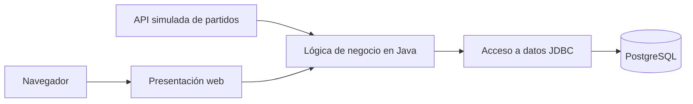

# Laboratorio 5 · Pregunta 1 en Java

Aplicación web de predicciones para partidos de ejemplo de la Champions League. Está desarrollada con Java 21, Spring Boot, Thymeleaf y PostgreSQL.

## Arquitectura y flujo de datos



Al iniciar, la aplicación obtiene todos los partidos de una API simulada en el servicio `source` y los guarda en PostgreSQL. La página consulta esa base para mostrar partidos y predicciones. Al registrar un marcador, la lógica valida los goles y calcula el ganador o empate; el resultado queda asociado al partido en la tabla de predicciones. Los partidos son datos de práctica, no un calendario oficial.

## Ejecutar localmente

1. Instalar Docker Desktop y activar su motor.
2. Desde esta carpeta, ejecutar `docker compose up -d --build`.
3. Abrir <http://localhost:8000>.
4. Verificar los servicios con `docker compose ps`.
5. Al terminar, ejecutar `docker compose down`. El volumen de PostgreSQL permanece y conserva las predicciones.

Si se desea usar otro puerto o credenciales, copiar `.env.example` como `.env` y modificar sus valores. Para borrar también los datos de práctica se puede ejecutar `docker compose down -v`.

## Comprobaciones sugeridas

- Ver que aparecen los tres partidos antes de registrar una predicción.
- Registrar un marcador y confirmar que aparece en la lista inferior.
- Revisar la tabla de PostgreSQL con `docker compose exec db psql -U lab5 -d champions -c "SELECT p.id,m.home,m.away,p.home_goals,p.away_goals,p.outcome FROM predictions p JOIN matches m ON m.id=p.match_id ORDER BY p.id;"`.
- Reiniciar con `docker compose restart` y confirmar que la predicción continúa visible.

## Despliegue en AWS

La imagen de la aplicación está publicada en GitHub Container Registry con la etiqueta `1.0`. Para desplegar sin credenciales del registro, se puede clonar este repositorio en una instancia EC2 con Docker y Docker Compose y compilar desde el código público:

```bash
git clone https://github.com/Miguel-ACD/el3304-lab5-pregunta1-java.git
cd el3304-lab5-pregunta1-java
docker compose up -d --build
```

La instancia necesita permitir tráfico entrante al puerto 8000. El servicio `source` usa el archivo JSON incluido en el repositorio y PostgreSQL guarda sus datos en el volumen `postgres_data`. Tras verificar la aplicación por la IP pública, detener o terminar la instancia para evitar mantener recursos activos. El paquete del registro puede mantenerse privado; el repositorio público basta para reproducir el despliegue.
